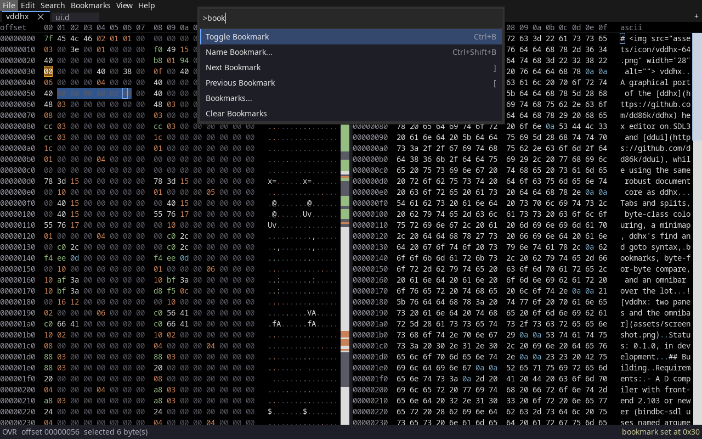

#  vddhx

A graphical port of the [ddhx](https://github.com/dd86k/ddhx) hex editor on
SDL3 and [ddui](https://github.com/dd86k/ddui), while using the same robust document core as ddhx.

Tabs and splits, byte-class coloring, a minimap, ddhx's find and goto syntax,
bookmarks, byte-for-byte compare, and an omnibar over the lot.



Currently supports Windows, macOS, and Linux.

## Building

Requirements:
- A D compiler with front-end 2.103 or newer (bindbc-sdl uses named arguments)
  - DMD: 2.103 or newer
  - GDC: 14 or newer (13 has the front-end, but its back-end crashes on bindbc-sdl)
  - LDC: 1.33 or newer
- DUB: Available via dlang.org (bundled with dmd) or your distro's package manager

The default configuration opens SDL3 dynamically at startup, so you'll need the
SDL3 and SDL3_ttf shared libraries installed (`libsdl3-0` and `libsdl3-ttf-0` on
Debian/Ubuntu, `SDL3.dll` and `SDL3_ttf.dll` beside the executable on Windows).

```
dub build
```

The `static` configuration links SDL3 in instead, for a binary that runs with
nothing installed, and needs the libraries built first:

```
dub build -c static
```

There are SDL3 static libraries build scripts available if SDL3 dynamic libraries
are unavailable. This makes building SDL3 static libraries easier.

These defaults to installing the libraries in `~/.local` or `.\install` on Windows:

```
dmd -run tools/build-sdl3.d       # or: rdmd tools/build-sdl3.d
gdmd -run tools/build-sdl3.d      # or: gdc -o build-sdl3 tools/build-sdl3.d && ./build-sdl3
ldmd2 -run tools/build-sdl3.d     # or: ldc2 -run tools/build-sdl3.d
```

Options go after the file name, e.g. `dmd -run tools/build-sdl3.d --help`.

## Variables

SDL reads a few environment variables of its own, useful for diagnostics or
preference.

- `SDL_RENDER_DRIVER`: Renderer, or a comma-separated list to try in order
  (`vulkan`, `opengl`, `software`, ...). Unset, SDL picks the first that works.
  If none of the listed ones work, vddhx warns and lets SDL pick.
- `SDL_VIDEO_DRIVER`: Video backend (`wayland`, `x11`, `windows`, ...).

## Files

Settings live in `.vddhxrc`, the first found of:
1. Home folder: `~/.vddhxrc` or `%USERPROFILE%\.vddhxrc`
2. User config: `$XDG_CONFIG_HOME/vddhx/.vddhxrc` (`~/.config/vddhx/.vddhxrc`)
   or `%LOCALAPPDATA%\vddhx\.vddhxrc`
3. System: `/etc/vddhx/.vddhxrc` or `%ProgramData%\vddhx\.vddhxrc`

The settings tab saves to the first two, never to the system file.

Key bindings use ddhx's lines and names, also editable in Settings > Keys:
```
bind h left
bind ctrl+k find-next
unbind ctrl+b
```

Colors use ddhx's `color SCHEME FG:BG` lines, also editable in Settings > Colors.
Values are ddhx's names (`red`, `brightblue`...) or `#rrggbb`:
```
color zero gray
color bookmark black:#d0a020
color selection :#304060
```
Schemes are ddhx's (`normal`, `zero`, `cursor`, `mirror`, `selection`, `bookmark`,
`diff-changed`, `diff-missing`) plus the byte classes `whitespace`, `control` and
`unmapped`. `normal` is printable bytes.

Each session logs to `vddhx.log`, the previous session's kept as `vddhx.log.old`:
- Linux and macOS: `$XDG_STATE_HOME/vddhx/` (`~/.local/state/vddhx/`)
- Windows: `%LOCALAPPDATA%\vddhx\`

Help > About links to the folder. `--verbose` and `--trace` log more; please
attach the log to bug reports.

## Hacking

`source/README.md` has the module map and the cross-module notes.

## License

MIT, see [LICENSE](LICENSE). Copyright (c) 2026, dd86k <dd@dax.moe>.

Dependencies:
- [ddhx](https://github.com/dd86k/ddhx) (MIT),
- [ddui](https://github.com/dd86k/ddui) (BSD-3-Clause),
- [ddlogger](https://github.com/dd86k/ddlogger) (BSL-1.0),
- [bindbc-sdl](https://github.com/BindBC/bindbc-sdl) (BSL-1.0),
- and [SDL3](https://github.com/libsdl-org/SDL) with SDL3_ttf (zlib).

The `static` configuration also links FreeType and HarfBuzz into the binary:
portions of that build are copyright (c) The FreeType Project
(<https://freetype.org>), all rights reserved.
